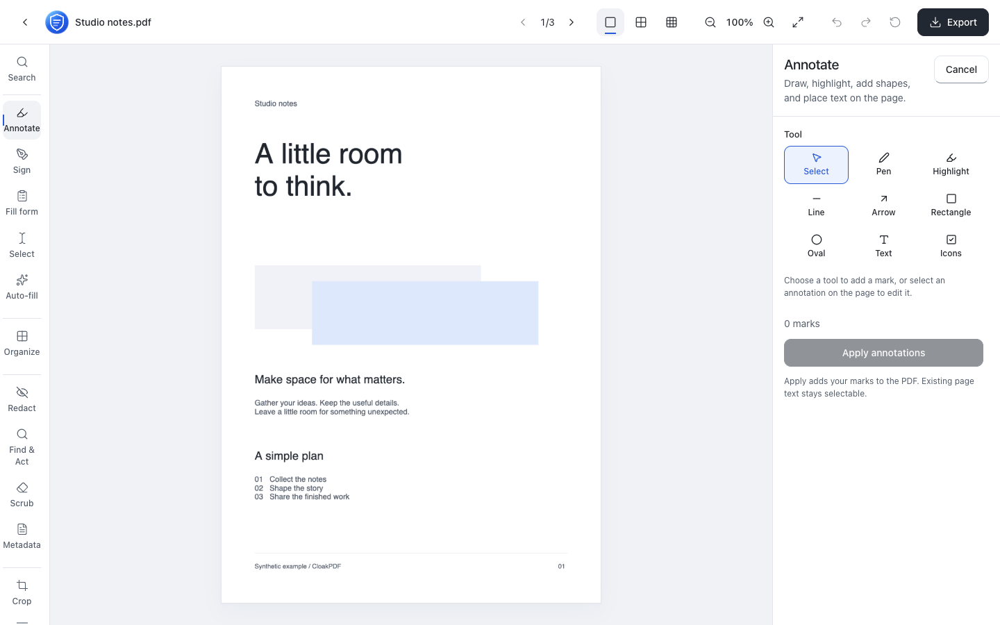

# CloakPDF

**Your documents. On your device.**

[Website](https://pdf.cloakyard.com/) · [Source](https://github.com/cloakyard/cloakpdf) · [Support](https://ko-fi.com/sumitsahoo21)

<p align="center">
    <a href="https://opensource.org/licenses/MIT"></a>
    
    <a href="https://securityscorecards.dev/viewer/?uri=github.com/cloakyard/cloakpdf"></a>
  </p>

<p align="center">
  <picture>
    <source media="(prefers-color-scheme: dark)" srcset="public/screenshots/editor-wide-dark.png">
    
  </picture>
</p>

## Overview

A private PDF editor and toolkit that processes documents in your browser. Open a PDF to edit, annotate, redact and export it, or choose a standalone workflow for multiple files, security or on-device questions.

## Features

Drop a PDF and it opens in a single, canvas-based **editor** — a Photoshop-like workspace for one document at a time. **22 editor tools and 7 standalone utilities** cover everything from a quick tick on a printed form to redaction, OCR, and on-device AI:

- **✏️ Annotate & sign** — draw, highlight, shapes, text (14 fonts, **bold** / _italic_ / underline), form-filling icons (tick / cross / dot / circle), signatures (draw with a real-pen ink feel, or a pressure-sensitive stylus — Apple Pencil, Wacom, S-Pen), fill & flatten forms (or auto-fill flat printed ones)
- **📄 Pages** — reorder, rotate, delete, crop (auto-trim & straighten), strip repeating headers/footers, N-up & booklet, OCR, plus split / extract / contact-sheet on export
- **🔒 Privacy** — redact (burned into the page), select or find & box text, erase regions (fill / blend / pixelate), scrub hidden data, edit or strip metadata
- **🏷️ Stamps & numbering** — watermarks (with dynamic date/page tokens), QR & barcode stamps, page numbers, headers & footers, Bates numbering, bookmarks, file attachments

Export to PDF, images (ZIP), a contact sheet, or split pages — with optional compress / grayscale / flatten / repair / strip-metadata.

The editor is keyboard-friendly: press **⌘K / Ctrl+K** to jump to any tool from a command palette, and undo/redo with the usual shortcuts.

A few **standalone tools** cover the jobs the single-PDF editor can't — these mirror the categories on the home screen:

- **🧩 Combine & Convert** — merge PDFs, build a PDF from images, or extract embedded images
- **🔑 Secure & Sign** — add a password & permissions, sign with a certificate, or compare two PDFs
- **🤖 On-device AI** — _Ask your PDF_: chat with a document using a small model that runs entirely in your browser, no API key or server

### On-device AI

**Ask your PDF** runs a full retrieval-augmented Q&A pipeline in the browser — the model weights download once from Hugging Face, cache, and work offline after. For the architecture (LangGraph state machine, hybrid retrieval, model choices), see **[docs/local-ai.md](docs/local-ai.md)**.

## Privacy

Everything runs client-side — there is no server to upload to. No accounts, no analytics, no tracking. It's an installable PWA. Cached tools work offline; OCR languages and optional AI models need an initial download. On-device AI needs no API key or inference server.

## Getting started

Open [pdf.cloakyard.com](https://pdf.cloakyard.com/) in a modern browser. Drop a PDF or browse for one, choose a tool, then export. Standalone cards handle multi-file jobs.

The installable PWA caches its core shell after loading. Optional language/model assets require their own initial download; cached availability depends on browser storage.

## Development

Requires Node.js 24 or newer and the Vite+ CLI (`npm install --global vite-plus`).

```bash
git clone https://github.com/cloakyard/cloakpdf.git
cd cloakpdf
vp install
vp dev       # http://localhost:5173
```

| Command                     | Description                                                          |
| --------------------------- | -------------------------------------------------------------------- |
| `vp dev`                    | Dev server with hot reload                                           |
| `vp run build`              | Type-check, build and verify deployment assets                       |
| `vp check`                  | Format, lint, type-check                                             |
| `pnpm check:dead`           | Audit unused code and dependencies                                   |
| `vp test run tests/unit`    | Run unit tests                                                       |
| `pnpm generate-icons`       | Rebuild PWA, touch, and legacy icons from the app-icon SVG           |
| `pnpm generate-screenshots` | Capture light/dark editor previews from a running production preview |
| `pnpm generate-og`          | Render the Air social card from local artwork and the editor capture |

### Verification

Run `vp check`, `pnpm check:dead`, `vp test run tests/unit` and `vp run build` before committing. Run the applicable browser suites from [CLAUDE.md](CLAUDE.md) against a production preview. AI inference checks are separate from deterministic dialog-state checks.

### Technology

| Area             | Technology                                                                                                                   |
| ---------------- | ---------------------------------------------------------------------------------------------------------------------------- |
| Framework        | [React 19](https://react.dev/) + [TypeScript 7](https://www.typescriptlang.org/)                                             |
| Styling          | [Tailwind CSS 4](https://tailwindcss.com/)                                                                                   |
| Build & tooling  | [Vite+ (`vp`)](https://viteplus.dev/)                                                                                        |
| PDF manipulation | [@pdfme/pdf-lib](https://github.com/pdfme/pdf-lib)                                                                           |
| PDF rendering    | [PDF.js](https://mozilla.github.io/pdf.js/)                                                                                  |
| Layout-aware OCR | [LlamaIndex LiteParse](https://www.llamaindex.ai/liteparse) + [Tesseract.js](https://tesseract.projectnaptha.com/)           |
| On-device AI     | [Transformers.js](https://github.com/huggingface/transformers.js) + [LangGraph](https://langchain-ai.github.io/langgraphjs/) |
| Deployment       | [Cloudflare Workers](https://workers.cloudflare.com/)                                                                        |

## Design and assets

[DESIGN.md](DESIGN.md) is the portable Air contract. [Surface coverage](docs/air/surfaces.json) and [validation](docs/air/validation.md) record actual states and remaining acceptance. UI changes use the pinned local Air bundle; document output retains its chosen appearance.

CloakPDF follows the shared Cloakyard mark and installed-app icon contract in
**[docs/logo-spec.md](docs/logo-spec.md)**. The circular UI mark lives at
`public/cloakpdf-mark.svg`; installable PWA assets are generated from the
separate, full-bleed `public/icons/cloakpdf-app-icon.svg`.

After changing the logo source, run `pnpm generate-icons`. Refresh application
captures with `pnpm generate-screenshots`, then run `pnpm generate-og` to render
the social composition. See [preview regeneration](docs/og-image.md) for the
local production server, dimensions and synthetic content. The README selects
the matching light/dark editor image; install previews also include phone layouts.

## Project structure

```text
cloakpdf/
├── src/editor/             # Document workspace, rail and editing tools
├── src/standalone/         # Multi-file, security and Ask PDF workflows
├── src/components/         # Shared application controls and overlays
├── src/styles/             # Pinned Air foundations and product composition
├── public/                 # Local assets, PWA icons and real editor captures
├── scripts/                # Asset generation and browser/design checks
├── tests/                  # Unit, browser and output checks
├── docs/                   # Architecture, privacy, design and validation records
└── wrangler.jsonc          # Cloudflare static Worker configuration
```

## Deployment and releases

The production build is served as static assets by Cloudflare Workers using `wrangler.jsonc`. Run `vp run build` before `vp preview` or a deployment dry run. Work on `dev`, open a PR into `main`, merge only after required checks pass, and update `dev` from `main`.

Only the configured main-branch deployment publishes production. Check the exact main commit, hosting result and live assets; a local build does not prove deployment.

## Contributing

Read [AGENTS.md](AGENTS.md), [CLAUDE.md](CLAUDE.md) and [DESIGN.md](DESIGN.md) before changes. See [CONTRIBUTING.md](CONTRIBUTING.md) for contribution and disclosure guidance. Keep changes bounded, preserve features and output, remove obsolete references, and record actual verification. Compare all applicable views in phone, tablet, laptop and desktop layouts, both themes.

The [family README standard](https://github.com/cloakyard/cloakyard/blob/main/docs/README_STANDARD.md) defines this document's section order. Support the project through [Buy me a coffee](https://ko-fi.com/sumitsahoo21).

## License

Released under the [MIT License](LICENSE). Third-party components retain their own licenses.

Built by [Sumit Sahoo](https://github.com/sumitsahoo), part of [Cloakyard](https://cloakyard.com/).
