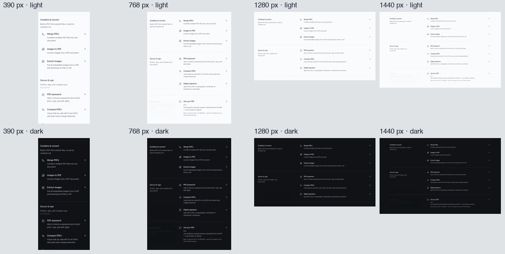

# CloakPDF landing motion and web dependencies

24 November 2026 · Air 1.8.1

Tool category introductions and the privacy summary. Tool buttons, search results, the file entry and editor stay immediately actionable.

The production landing passed 22 viewport sizes in both themes in Chromium and
WebKit. The browser measured the combined 520 ms wipe, fade and 4 px settle,
checked the stagger where blocks enter together, and scrolled back through the
page to check that blocks play once. Focus, initial fragments, return from
privacy, live reduced motion, print, forced colours and the missing-observer
fallback passed. A touch profile also checked direct navigation with reduced motion.

## Dependencies and feature coverage

Compared all 31 direct web runtime and development package declarations with
the npm registry and refreshed the lockfile. Vite+ 1.8.0 and LiteParse WASM 2.21.1. The editor smoke checks produced text and Markdown from a real PDF in desktop and mobile layouts.

Frozen pnpm installation, build, type/lint/format checks, Knip, package audit and 474 unit tests. The entry and responsive-motion suites exercised search, file handoff, the anchored tool rows, keyboard selection and editor arrival. Standalone checks used the repository’s demo fixtures.

This review covered the web landing and the listed regression checks on local
builds. Physical-device and assistive-technology acceptance remain open.
